<div align="center">

# Apple Music Liquid Glass

### A Spicetify theme for Spotify

**Make Spotify look like Apple Music, with the frosted Liquid Glass style of iOS 26 and macOS Tahoe.**

[](https://github.com/Raitofod/spicetify-apple-music-liquid-glass/releases/latest)
[](#compatibility)
[](#installation)
[](#dark-or-light)
[](https://github.com/Raitofod/spicetify-apple-music-liquid-glass/stargazers)

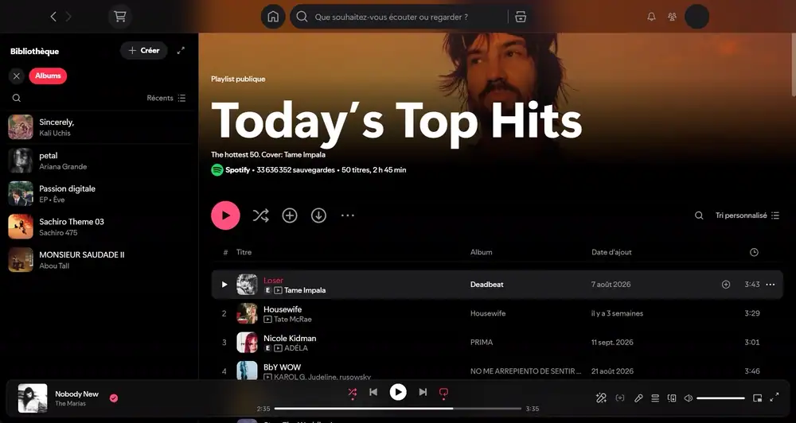

**[Install](#installation) · [Screenshots](#screenshots) · [Report a bug](https://github.com/Raitofod/spicetify-apple-music-liquid-glass/issues/new/choose)**

</div>

Pages scroll under see-through bars and a floating glass player, lyrics sit on your blurred album art, and everything gets rounded covers and the Apple Music pink accent.

**Like it? [Leave a star](https://github.com/Raitofod/spicetify-apple-music-liquid-glass/stargazers).** The Marketplace ranks themes by stars, so each one helps other people find this theme.

## Why this theme

- **Real glass.** The top bar, the search suggestions, the filter bars, track list headers, menus and dialogs blur the page scrolling behind them.
- **Floating player.** The now-playing bar is a rounded glass capsule, with pages, the library and side panels scrolling underneath.
- **Immersive pages.** Artist and playlist photos run up under the glass and fade into the page, with no tinted Spotify gradients.
- **Lyrics over your artwork.** The lyrics page and the fullscreen view show the current cover, blurred, and follow every track change.
- **Apple Music details.** Rounded covers, big bold titles and the `#FA2D48` pink accent, with no leftover Spotify green.
- **Fast.** The theme avoids `:has()` selectors, which caused freezes of about 400 ms when moving the mouse quickly over track lists.

## Dark or Light

Two complete colour schemes, lyrics and fullscreen views included.

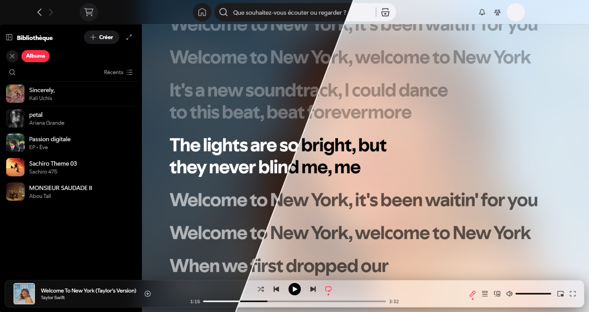

## Screenshots

| Dark | Light |
| --- | --- |
| **Glass search suggestions** | |
| 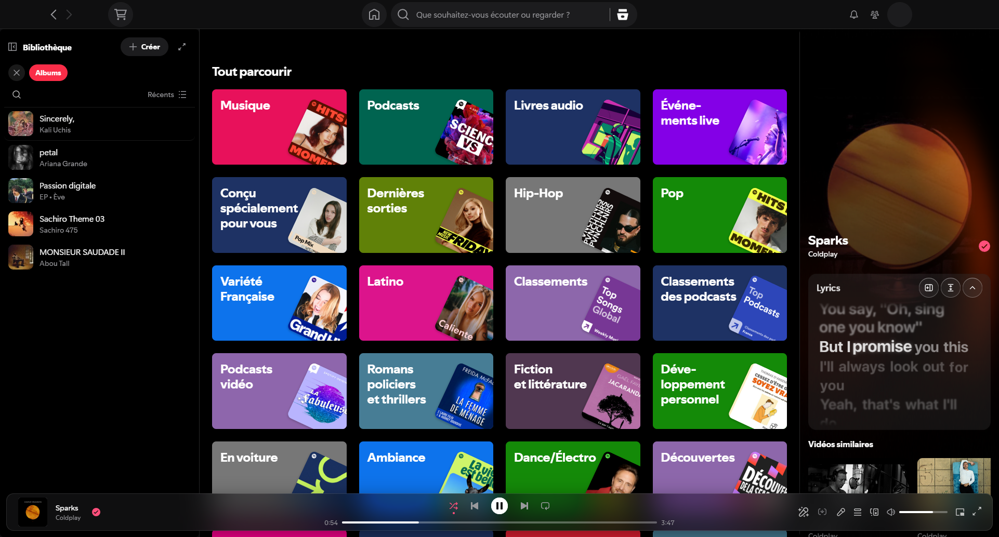 | 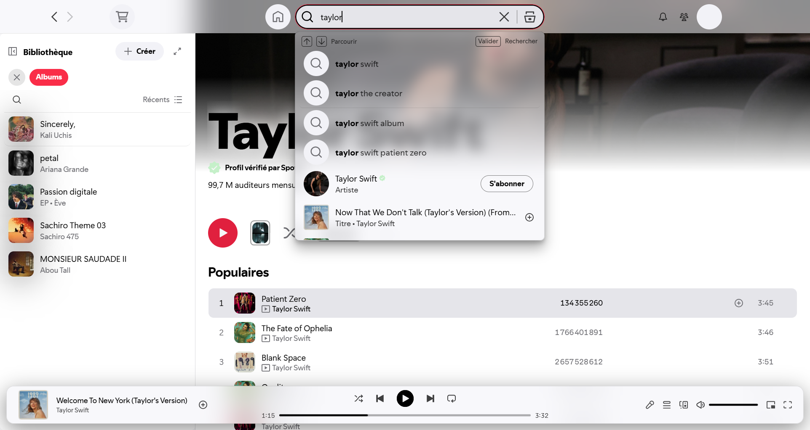 |
| **Playlist under the glass bar** | |
| 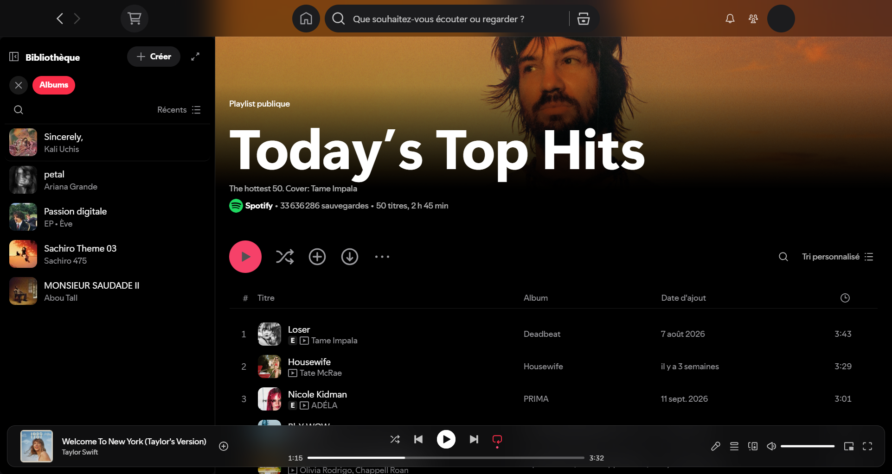 | 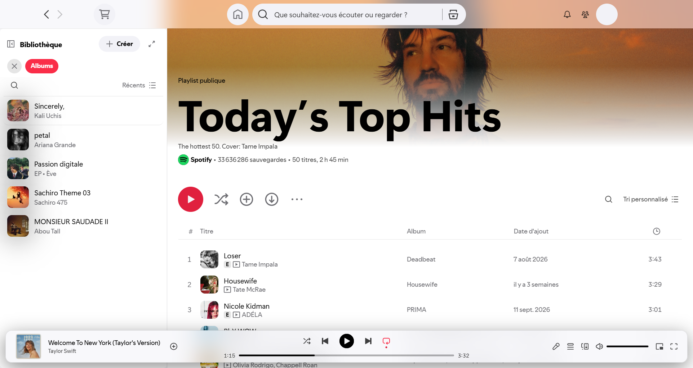 |
| **Lyrics over the blurred cover** | |
| 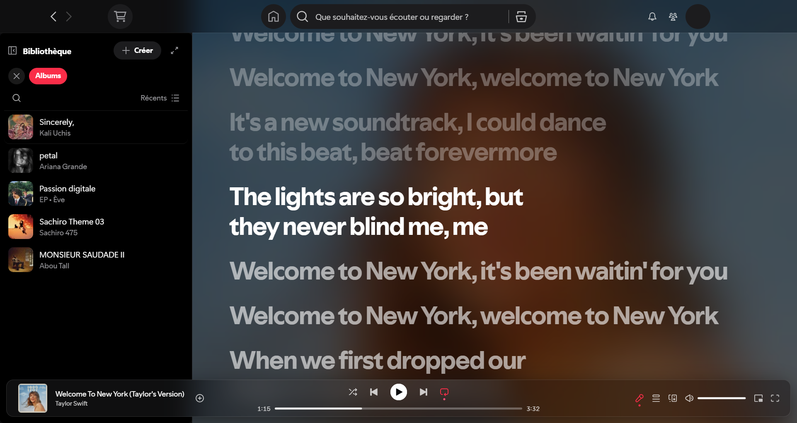 | 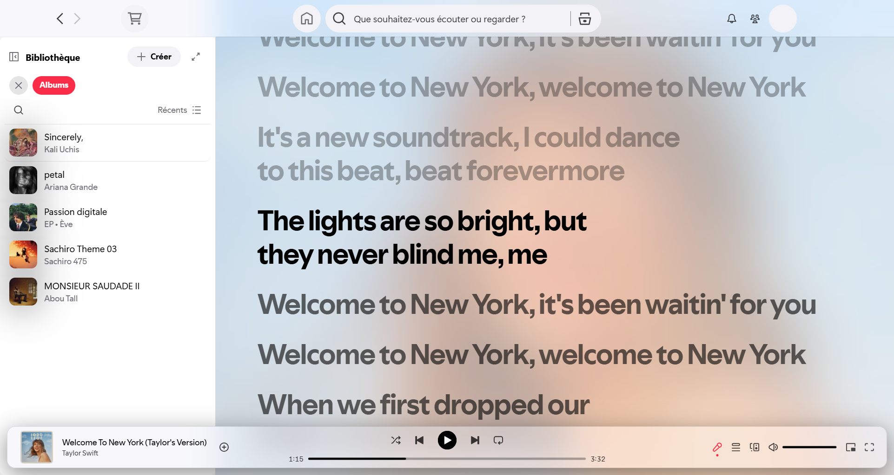 |

<details>
<summary><b>More screenshots</b></summary>

| Dark | Light |
| --- | --- |
| **Fullscreen lyrics** | |
| 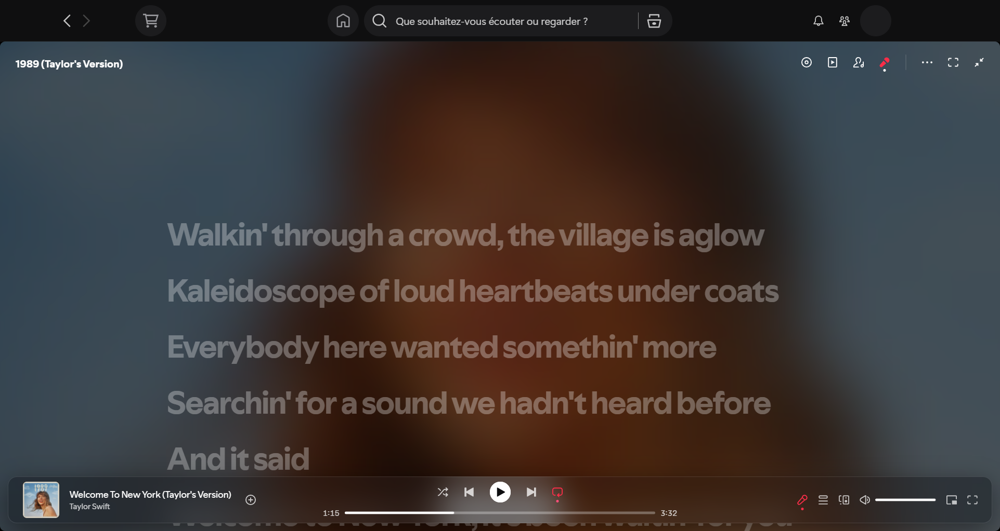 | 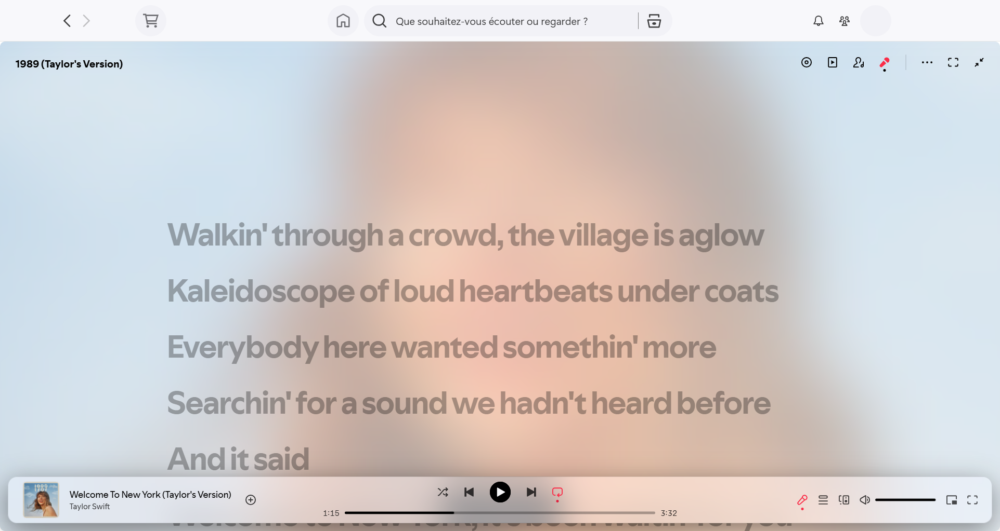 |
| **Artist page** | |
| 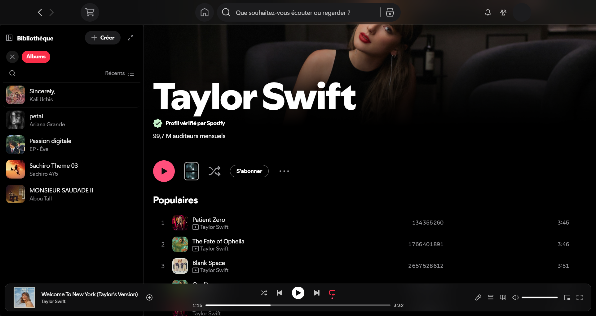 | 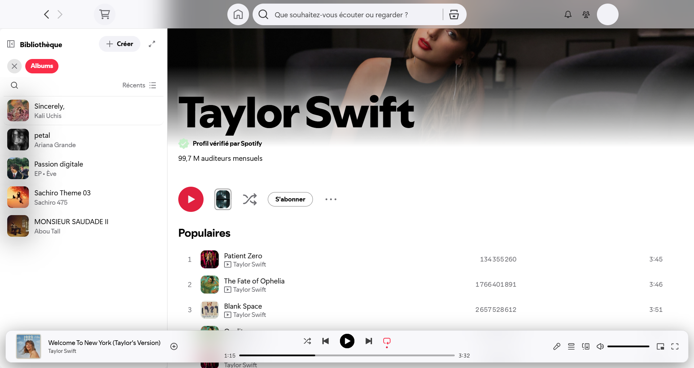 |
| **Glass filter bar on search results** | |
| 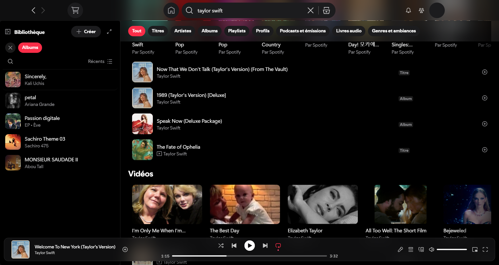 | 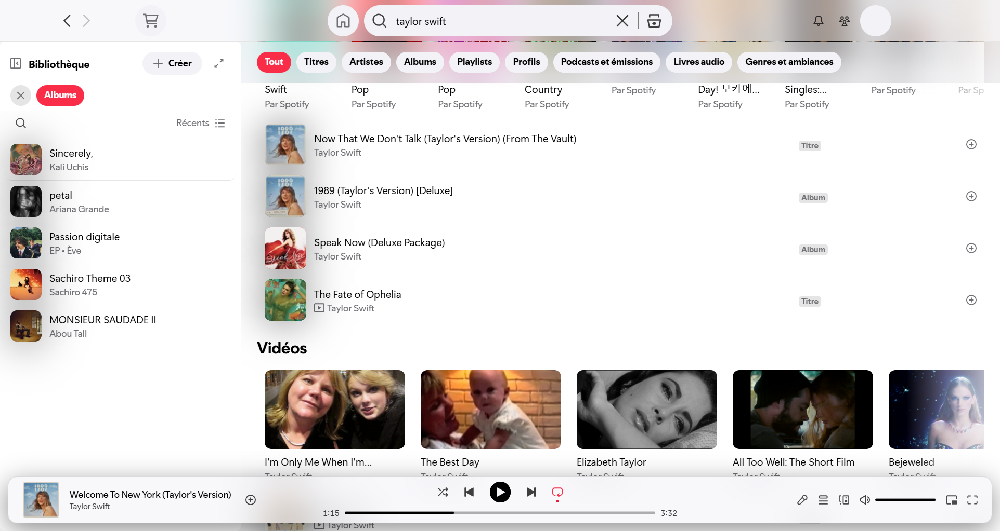 |
| **Sticky glass header** | |
| 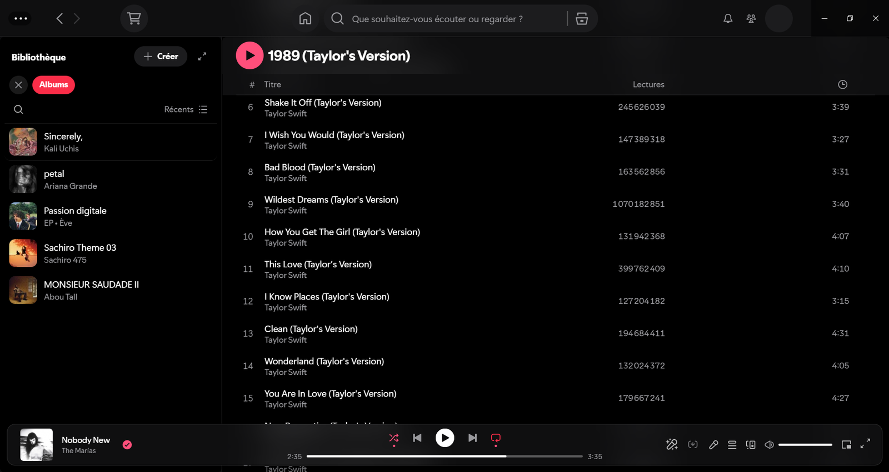 | 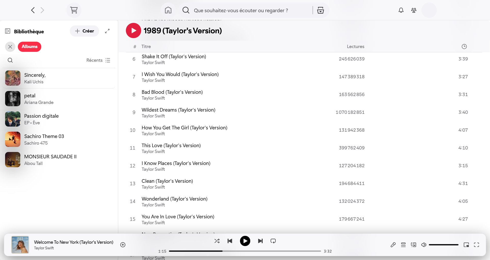 |
| **Glass context menu** | |
| 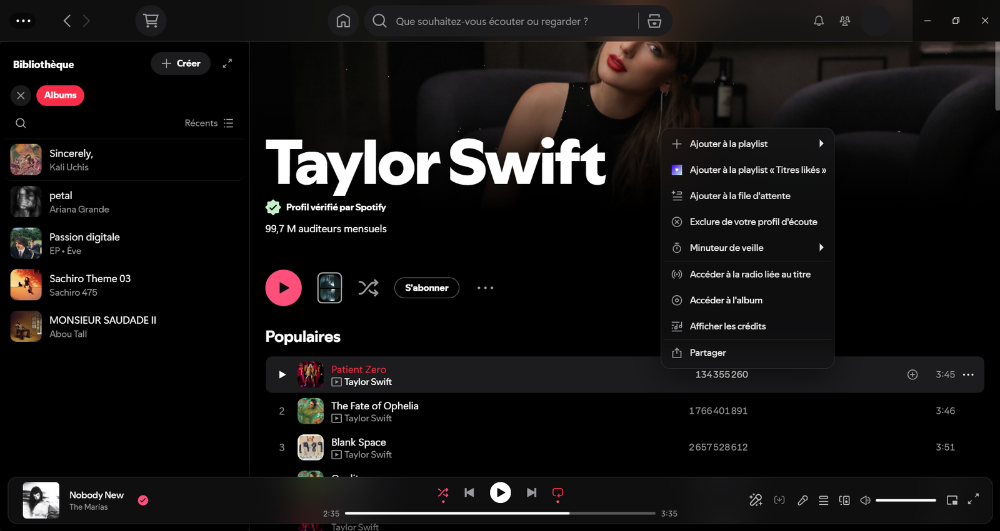 | 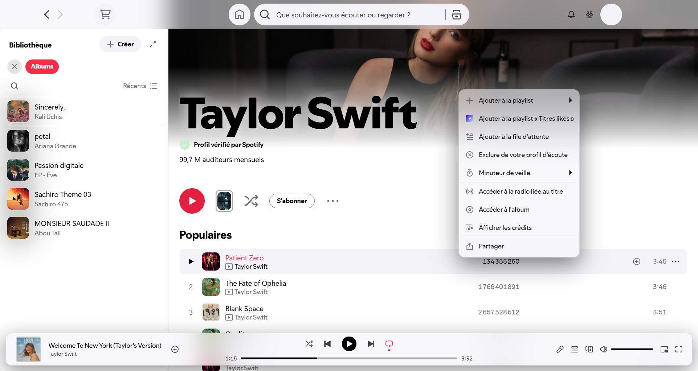 |

</details>

## Installation

You need [Spicetify](https://spicetify.app) installed first.

### Install from the Marketplace

1. Open the **Marketplace** tab in Spotify, then **Themes**.
2. Set the sort order to **Last Updated** or **Newest**.
3. Search for **Apple Music Liquid Glass** and install it.

The Marketplace search only looks through the themes it has already loaded, which is why the sort order above matters.

### Manual install

**Windows (PowerShell)**

```powershell
git clone --depth 1 https://github.com/Raitofod/spicetify-apple-music-liquid-glass "$env:TEMP\am-glass"
Copy-Item "$env:TEMP\am-glass\AppleMusic" "$(spicetify path userdata)\Themes" -Recurse -Force
spicetify config current_theme AppleMusic color_scheme Dark inject_css 1 replace_colors 1 inject_theme_js 1
spicetify apply
```

**macOS / Linux**

```bash
git clone --depth 1 https://github.com/Raitofod/spicetify-apple-music-liquid-glass /tmp/am-glass
cp -r /tmp/am-glass/AppleMusic "$(spicetify path userdata)/Themes/"
spicetify config current_theme AppleMusic color_scheme Dark inject_css 1 replace_colors 1 inject_theme_js 1
spicetify apply
```

To use the Light scheme, run `spicetify config color_scheme Light` followed by `spicetify apply`.

### Switch back

Set another theme with `spicetify config current_theme <name>` and then run `spicetify apply`. `spicetify restore` removes every Spicetify change, including this theme.

## Inspiration

- **Apple Music** gives the layout: flat black pages, `#1C1C1E` raised surfaces, big bold titles, rounded artwork and the pink/red accent (`#FA2D48`).
- **Liquid Glass**, the translucent material Apple introduced across iOS 26 and macOS Tahoe, gives the surfaces. Bars, menus and the player are see-through panes, close to what is often called glassmorphism.

This is a fan-made theme. It is not affiliated with, endorsed by or connected to Apple or Spotify.

## What each file does

| File | Role |
| --- | --- |
| `AppleMusic/color.ini` | The `Dark` and `Light` colour schemes |
| `AppleMusic/user.css` | All the styling |
| `AppleMusic/theme.js` | Small helpers that CSS cannot do alone. It rounds covers without squaring artist pictures, feeds the current cover to the lyrics background and flags the current page. This is why the Marketplace shows an "external JS" tag. |

## Compatibility

Tested on Spotify 1.3.8 with Spicetify 2.46 on Windows 11, on its own and with Spicy Lyrics. macOS builds use different internal class names, so the layout hangs on ids and test ids shared by both platforms; the macOS result was checked against the macOS build's stylesheet, not on a real Mac. Spotify renames its internal classes often, so a Spotify update can break parts of the look.

**Known limits:**
- The lyrics background needs a track to be playing.
- On Windows, Spotify draws its own dark veil behind the minimize, maximize and close buttons. A theme can't remove it, so it shows as a grey block in the Light scheme.

## Feedback

Found a bug, or have an idea? [Open an issue](https://github.com/Raitofod/spicetify-apple-music-liquid-glass/issues), with a screenshot and your system if you can. Ideas to improve the theme are very welcome.

## License

[MIT](LICENSE). Apple Music is a trademark of Apple Inc. Spotify is a trademark of Spotify AB.
