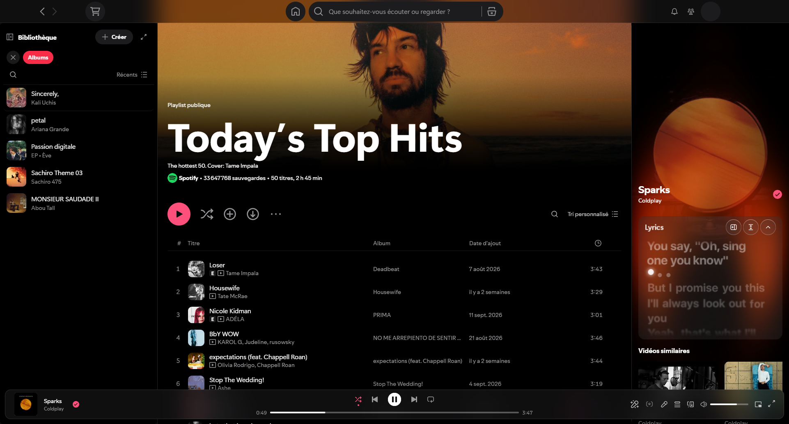

# Apple Music Liquid Glass — a Spicetify theme

**An Apple Music look for the Spotify desktop app, built around Apple's Liquid Glass.** Frosted translucent bars, a floating glass player, lyrics over the blurred album art, rounded covers and the Apple Music pink accent. Dark and Light schemes.



## Inspiration

- **Apple Music** gives the layout: flat black pages, `#1C1C1E` raised surfaces, big bold titles, rounded artwork and the pink/red accent (`#FA2D48`).
- **Liquid Glass**, the translucent material Apple introduced across iOS 26 and macOS Tahoe, gives the surfaces. Bars, menus and the player are see-through panes that blur and saturate the content scrolling underneath.

This is a fan-made theme. It is not affiliated with, endorsed by or connected to Apple or Spotify.

## Features

- **Glass everywhere it matters.** The top bar, page headers, sticky track-list headers, context menus and dialogs all blur the page behind them (`backdrop-filter: blur() saturate()`).
- **Floating player.** The now-playing bar is a rounded glass capsule. Pages, the library and side panels scroll underneath it.
- **Immersive pages.** Artist and playlist photos run up under the glass top bar and fade into the page. Spotify's tinted gradients are removed.
- **Lyrics over the artwork.** The lyrics page shows the current cover, heavily blurred, behind the words. It updates on every track change.
- **Rounded covers.** Square covers get Apple-style corners and circular artist pictures stay round.
- **Apple Music accent.** Play buttons, toggles, chips and the progress bar on hover use the pink accent, with no leftover Spotify green.
- **Two schemes.** `Dark` (default) and `Light`.
- **Fast.** The theme uses no `:has()` selectors, which cost ~400 ms freezes when moving the mouse quickly over track lists. Hovering stays within a few milliseconds of stock Spotify.

## Screenshots

| Artist page | Sticky glass header |
| --- | --- |
|  |  |
| **Lyrics over the blurred cover** | **Glass context menu** |
|  |  |
| **Search** | **Light scheme** |
|  |  |

## Installation

You need [Spicetify](https://spicetify.app) installed first.

### Marketplace

1. Open the **Marketplace** tab in Spotify.
2. Go to **Themes**.
3. Search for **Apple Music Liquid Glass** and install it.

### Manual

**Windows (PowerShell)**

```powershell
git clone --depth 1 https://github.com/Raitofod/spicetify-apple-music-liquid-glass "$env:TEMP\am-glass"
Copy-Item "$env:TEMP\am-glass\AppleMusic" "$(spicetify path userdata)\Themes" -Recurse -Force
spicetify config current_theme AppleMusic color_scheme Dark inject_css 1 replace_colors 1 inject_theme_js 1
spicetify apply
```

**macOS / Linux**

```bash
git clone --depth 1 https://github.com/Raitofod/spicetify-apple-music-liquid-glass /tmp/am-glass
cp -r /tmp/am-glass/AppleMusic "$(spicetify path userdata)/Themes/"
spicetify config current_theme AppleMusic color_scheme Dark inject_css 1 replace_colors 1 inject_theme_js 1
spicetify apply
```

To use the Light scheme, run `spicetify config color_scheme Light` followed by `spicetify apply`.

### Switch back

Set another theme with `spicetify config current_theme <name>` and then run `spicetify apply`. `spicetify restore` removes every Spicetify change, including this theme.

## What each file does

| File | Role |
| --- | --- |
| `AppleMusic/color.ini` | The `Dark` and `Light` colour schemes |
| `AppleMusic/user.css` | All the styling |
| `AppleMusic/theme.js` | Two small helpers that CSS cannot do alone. It rounds covers without squaring artist pictures, and feeds the current cover to the lyrics background. |

## Compatibility

Tested on Spotify 1.3.6 with Spicetify 2.46 on Windows 11. Spotify renames its internal classes often, so a Spotify update can break parts of the look. If that happens, please [open an issue](https://github.com/Raitofod/spicetify-apple-music-liquid-glass/issues) with a screenshot.

**Known limits:**
- The search page filter bar stays opaque, because it has no stable hook.
- The lyrics background needs a track to be playing.

## License

[MIT](LICENSE). Apple Music is a trademark of Apple Inc. Spotify is a trademark of Spotify AB.
